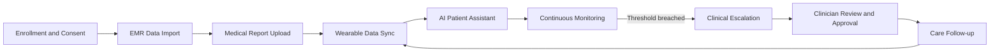
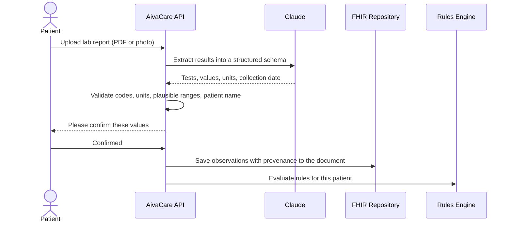
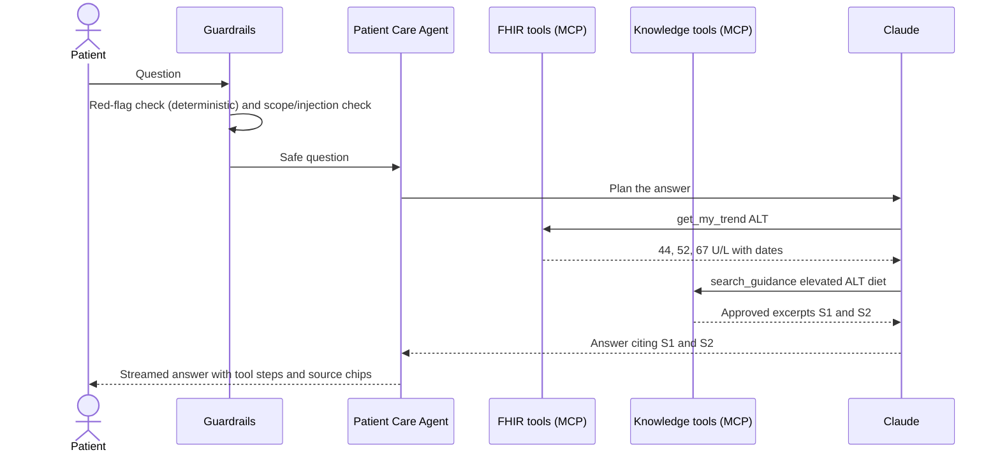
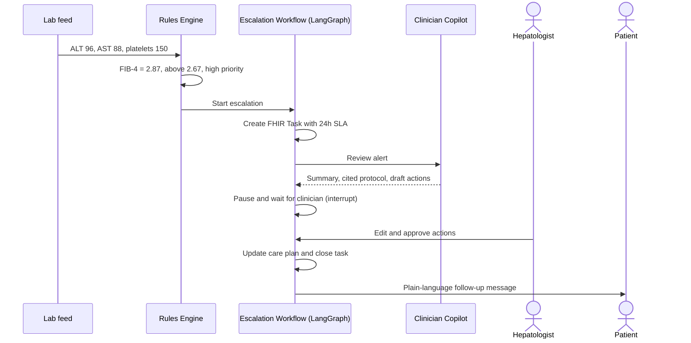
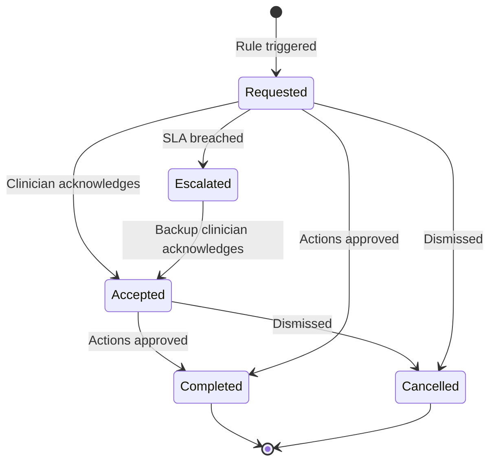
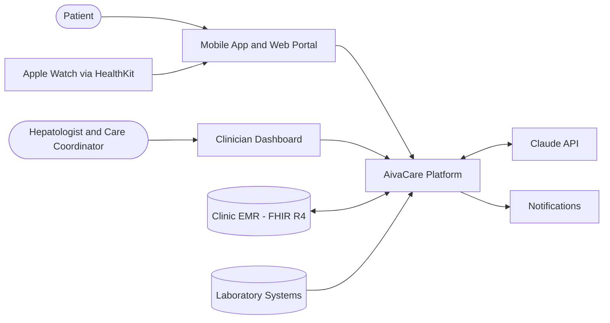
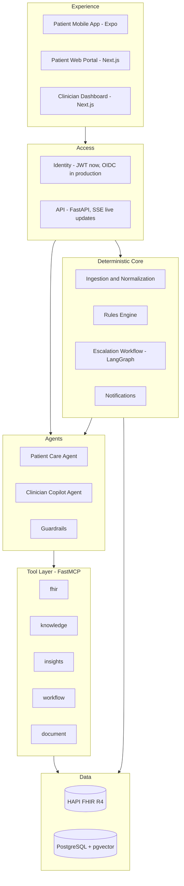

# AivaCare - Agentic AI Continuous Care Platform
### Solution Architecture Document

| | |
|---|---|
| **Client** | LiverWell Clinic |
| **Domain** | Fatty liver disease (MASLD / MASH) |
| **Version** | 1.0 - roadshow prototype |
| **Date** | 31 October 2026 |
| **Status** | Prototype on synthetic data. Not for clinical use. |

---

## 1. Problem Statement

LiverWell Clinic treats patients with fatty liver disease using an **appointment-based model**: a hepatology visit every three months and periodic blood tests. Many patients also track their own health on wearables.

**Example patient: John Miller, 48, diagnosed with MASLD**
- He sees his hepatologist every 3 months and has periodic lab tests.
- His Apple Watch tracks activity, heart rate, sleep and weight every day.
- His medical records, lab results and wearable data sit in **separate systems that don't share data**.

| For the patient | For the care team |
|---|---|
| Can't make sense of health trends between visits | No visibility into progress between appointments |
| No personalized guidance when questions come up | Concerning trends are noticed late, so interventions are delayed |
| Hard to stick to diet, activity and medication plans | Coordinating follow-ups by hand takes a lot of effort |

**Goal:** move LiverWell to a **continuous care model**. Specialized AI agents monitor patients proactively, give personalized support, and coordinate timely clinical interventions. **Physicians stay in control, and clinical safety is guaranteed.**

**Success measures**
- Patient engagement and treatment adherence
- Time from a concerning finding to clinician acknowledgment
- Percentage of escalations resolved within the SLA
- Clinical trends across the patient population: weight, ALT/AST, FIB-4, HbA1c
- Hours saved on routine care coordination

---

## 2. Solution Overview

AivaCare is a secure, multi-agent AI platform with three entry points: a **patient mobile app**, a **patient web portal**, and a **clinician care dashboard**.

### Design principles

| # | Principle | What it means |
|---|---|---|
| 1 | **Rules decide, AI explains, physicians approve** | Deterministic rules detect clinical risk. AI interprets the finding and communicates it. Clinicians make every clinical decision. |
| 2 | **Agents only where judgment is needed** | Two AI agents handle conversation and reasoning. Everything else is a deterministic service or a single-purpose AI tool. |
| 3 | **Facts from records, knowledge from approved sources** | Numbers come straight from the clinical record. Guidance comes only from clinician-approved content, and answers cite their sources. |
| 4 | **Governed access** | Agents reach data and actions only through controlled tool servers (MCP), scoped to the signed-in user, with every call audited. |
| 5 | **Standards-based** | HL7 FHIR R4 is the system of record, so the platform can integrate with any modern EMR. |

---

## 3. Capabilities

| Capability | What it delivers | Delivered by |
|---|---|---|
| **Unified Patient 360** | One record over time that combines EMR, lab, history and wearable data | Ingestion service → HAPI FHIR repository |
| **Medical Document Intelligence** | Patients upload reports; AI extracts, validates and summarizes them | Claude document extraction + validation + patient confirmation |
| **AI Patient Assistant** | Personalized answers grounded in the patient's own record and approved knowledge, with sources cited | **Patient Care Agent** + RAG |
| **Continuous Monitoring** | Checks incoming data and trends against thresholds set by clinicians | Deterministic rules engine (versioned rule catalog) |
| **Clinical Escalation** | Prioritized alerts with SLAs, tracked until resolved | LangGraph escalation workflow + FHIR Task |
| **Clinician Insights** | AI alert reviews, Patient 360, Copilot Q&A, draft care-plan changes | **Clinician Copilot Agent** + alert-review tool |
| **Patient Engagement** | Reminders, follow-up messages, progress summaries | Notification service + follow-up writer tool |
| **Governance & Safety** | Human approval, guardrails, audit trail, red-flag bypass | Guardrails, audit log, approval interrupts |

### Why two agents and not more
- **One agent per trust boundary.** The Patient Care Agent handles untrusted patient input and can only touch that patient's data. The Clinician Copilot serves authenticated clinicians and reaches only their assigned panel.
- **Safety-critical logic stays deterministic.** Detection, escalation, SLAs and the red-flag path are rule-based, auditable and unit-tested.
- **Lower risk and cost.** Fewer AI decision points mean less evaluation and validation effort, lower latency and a lower cost per interaction.

---

## 4. Process Flows

### 4.1 End-to-end patient journey

### 4.2 Medical report upload

### 4.3 Grounded patient question and answer

Example question: *"Why is my ALT high and what should I eat?"*

If a **red-flag symptom** is detected (yellow eyes or skin, vomiting blood, black stools, confusion, abdominal swelling), the AI is bypassed. The patient immediately gets urgent-care instructions and a high-priority escalation is created.

### 4.4 Monitoring → escalation → clinician approval → follow-up

### 4.5 Escalation lifecycle

Each escalation is stored as a FHIR **Task**, with a priority, an owner, an SLA deadline, the rule evidence, the AI review, the clinician's decision and an audit trail. The workflow state is checkpointed in Postgres, so a pending approval survives restarts. SLA re-escalation is planned for the pilot phase.

---

## 5. System Landscape

### 5.1 Context diagram

### 5.2 Layered architecture

### 5.3 Technology stack

| Layer | Technology |
|---|---|
| Patient mobile app | React Native / Expo, streaming chat over `expo/fetch` |
| Web portal and dashboard | Next.js, Tailwind CSS, Recharts, Vercel AI SDK UI (streaming chat) |
| Backend | Python 3.12, FastAPI, Server-Sent Events |
| LLM | Claude API via the official Anthropic SDK: Claude Opus 5.5 (agents, reviews, extraction) and Claude Haiku 5.5 (guardrail classification, follow-up messages), with server-side refusal fallback |
| Agent orchestration | Streaming Claude tool loop; **LangGraph** for the escalation workflow (Postgres checkpointer, `interrupt()` for human approval) |
| Tool integration | **FastMCP**: five servers composed per request, called through an in-process MCP client |
| RAG | PostgreSQL + **pgvector**, local embeddings (BAAI bge-small via fastembed), hybrid vector + full-text search |
| Interoperability | **HAPI FHIR R4** with LOINC, SNOMED CT and RxNorm coding |
| Rules | Python rules engine over a versioned YAML rule catalog |
| Infrastructure | Docker Compose, Caddy (automatic HTTPS), GitHub |

### 5.4 Agents

| | **Patient Care Agent** | **Clinician Copilot Agent** |
|---|---|---|
| **Users** | Patients (untrusted input) | Hepatologists and care coordinators |
| **Purpose** | Q&A, education, coaching, symptom logging, appointment requests | Alert review, Patient 360 questions, protocol lookup, draft care-plan changes |
| **Data scope** | The signed-in patient only | The assigned patient panel |
| **Can write** | Symptom logs, appointment requests, confirmed report data | Care-plan *proposals* only; applying them needs clinician approval |
| **Never** | Diagnoses, changes medication, handles emergencies on its own | Makes clinical changes without physician sign-off |

**Single-purpose AI tools** (one structured call each, evaluated in isolation):
- **Alert review:** summary, cited protocol and draft actions.
- **Document extraction:** lab report → validated schema.
- **Follow-up writer:** plain-language message to the patient.
- **Guardrail classifier:** in scope, out of scope, or prompt injection.

### 5.5 Tool layer (MCP)

| Server | Patient tools | Clinician tools |
|---|---|---|
| **fhir** | `get_my_profile`, `get_my_trend`, `get_my_latest_results`, `get_my_care_plan` | `list_patient_panel`, `get_patient_summary`, `get_trend` |
| **knowledge** | `search_guidance` (patient content) | `search_guidance` (clinician + patient content) |
| **insights** | `get_my_progress` | `get_risk_flags` (rules engine) |
| **workflow** | `log_symptom`, `request_appointment` | `list_open_alerts`, `propose_careplan_change` |
| **document** | `list_my_documents` | `list_patient_documents` |

**Security controls in the tool layer**
- **Identity comes from the login token, never from the AI.** Patient tools have no patient-ID parameter, so a prompt cannot request another patient's data.
- **Panel checks.** Clinician tools verify that the patient is in the clinician's panel.
- **Proposals, not changes.** Clinical writes become drafts that a clinician must approve.
- **Full audit.** Every consequential action is written to the audit log.

### 5.6 Knowledge and RAG

| Information | Source | Retrieval |
|---|---|---|
| Labs, vitals, wearables, medications, care plan | FHIR repository | **Exact query through tools** (never similarity search) |
| Patient education, clinic protocols | Clinician-approved markdown with version and approver metadata | **RAG** filtered by audience, with a similarity threshold |

When no approved content matches, the assistant says so and offers to contact the care team instead of guessing.

### 5.7 Clinical rule catalog (demo values; clinical sign-off required)

| Rule | Threshold | Priority / SLA |
|---|---|---|
| FIB-4 high | > 2.67 | High / 24h |
| FIB-4 indeterminate | 1.3 - 2.67 | Medium / 72h |
| ALT above 3× upper limit of normal | > 120 U/L | High / 24h |
| ALT doubled from the patient's baseline | ≥ 2.0× | Medium / 72h |
| Weight gain | > 3% in 30 days | Low / 7d |
| Resting heart rate rise | > 8 bpm vs. baseline | Low / 7d |
| Activity drop | > 50% vs. baseline | Low / 7d |
| Red-flag symptoms | Keyword patterns | High / immediate patient instructions |

### 5.8 Security, privacy and compliance

| Area | Prototype | Production |
|---|---|---|
| Identity | Demo personas, signed JWT, role checks | OIDC SSO (e.g. Keycloak or Identity Platform), MFA for clinicians, SMART on FHIR launch from the EMR |
| Data protection | Synthetic data only, HTTPS | Encryption at rest with customer-managed keys, PHI redaction in logs, minimum-necessary data sent to the LLM |
| AI safety | Red-flag bypass, scope and injection classifier, citations, draft-only clinical writes | Plus evaluation suites in CI, red-team tests, sampled clinician review |
| Audit | Audit log table | FHIR AuditEvent and Provenance, immutable log storage |
| Regulatory | Not applicable (demo) | HIPAA safeguards and BAAs (hosting and LLM provider); non-device CDS positioning under FDA guidance; ONC HTI-1 transparency |

---

## 6. Deployment

### 6.1 Roadshow prototype

| Item | Choice |
|---|---|
| Hosting | One GCP Compute Engine VM running Docker Compose in a dedicated `aivacare` project |
| Services | HAPI FHIR, PostgreSQL + pgvector, API, web, Caddy (HTTPS) |
| Mobile | Android preview APK (EAS); Expo Go and the responsive web portal as fallbacks |
| Cost control | Start the VM before demos and stop it afterwards (only disk is billed when stopped); rate limits and a spend cap on the Claude API |
| Fallback | The same Compose stack runs on the presenter's laptop |

### 6.2 Production target (GCP)

| Component | Service |
|---|---|
| Web and API | Cloud Run (autoscaling) |
| FHIR store | Cloud Healthcare API (FHIR R4) or managed HAPI on GKE |
| Database | Cloud SQL for PostgreSQL with pgvector |
| Events | Pub/Sub, FHIR notifications |
| Secrets | Secret Manager |
| Observability | Cloud Logging and Monitoring, Langfuse or OpenTelemetry for agent traces |
| LLM | Claude via the Anthropic API or Vertex AI, under a BAA |

---

## 7. Implementation Steps

### 7.1 Completed: roadshow prototype

| Step | Delivered |
|---|---|
| 1. Foundation | Docker Compose stack, HAPI FHIR, Postgres/pgvector, synthetic data (John Miller's 12-month story + 8 panel patients), wearable simulator |
| 2. Patient 360 and Assistant | MCP tool servers, RAG over approved content, streaming Patient Care Agent with citations, guardrails |
| 3. Safety core and HITL | Rules engine, event-driven escalations, LangGraph workflow with approval interrupt, Clinician Copilot, live alert queue |
| 4. Document AI and engagement | Report upload → extraction → validation → confirmation → FHIR; follow-up messages and notifications |
| 5. Experience | Patient web portal, clinician dashboard, presenter controls, Expo mobile app |

### 7.2 Next: pilot (about 3 months)

| Phase | Focus | Exit criteria |
|---|---|---|
| Discovery (2 weeks) | Clinical sign-off of the rule catalog and content; EMR and lab integration design; security review | Signed-off scope and rules |
| Integration (4 weeks) | EMR FHIR API, lab HL7 v2 feed, HealthKit sync in a native iOS build, OIDC SSO | Real data flowing in a test environment |
| Hardening (4 weeks) | Evaluation suites in CI, SLA re-escalation, observability, PHI controls, penetration test | Eval and security gates pass |
| Pilot (4+ weeks) | 25-50 consenting patients; clinician feedback; tuning thresholds | Engagement and response-time targets met |

### 7.3 Production
- HIPAA-eligible hosting and BAAs.
- Clinical safety case and hazard log.
- Disaster recovery.
- Scale to the full patient population.
- Extend to related conditions such as diabetes and obesity.

---

## 8. Risks, Assumptions and Open Questions

| Risk | Mitigation |
|---|---|
| Unsafe or inaccurate AI advice | Grounding in approved content only, citations, guardrails, red-flag bypass, eval gates |
| Alert fatigue | Tiered priorities, clinician-tunable thresholds, one task per patient event, AI summaries for context |
| Document extraction errors | Validation rules, patient confirmation, provenance |
| Cross-patient data exposure | Identity bound into tools, panel checks, audit |
| Regulatory classification | Non-device CDS positioning; a physician makes every clinical decision |

**Assumptions**
- The prototype uses synthetic data and simulated wearables.
- Clinical content and rule thresholds are demo values that need clinician review.

**Open questions for LiverWell**
1. Which EMR do you use, and does it offer FHIR R4 API access?
2. How are lab results delivered today (HL7 v2, FHIR or a portal)?
3. Who triages alerts, during which hours, and with what response times?
4. Which therapies and protocols are in scope?
5. How many patients will be in the pilot and in full rollout?
6. Do you have a preferred hosting environment?
